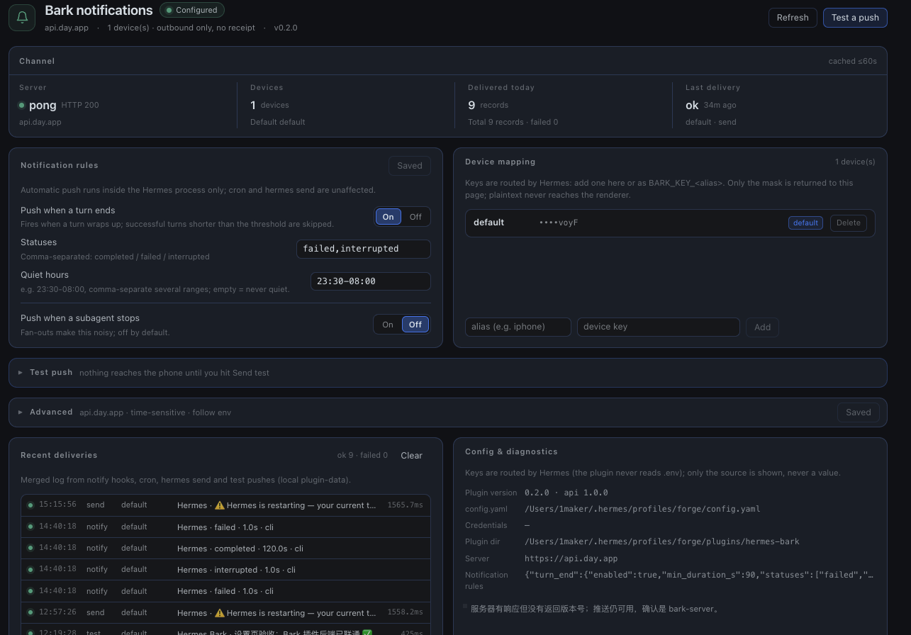

# hermes-bark

Send-only **Bark** push notifications for [Hermes Agent](https://hermes-agent.nousresearch.com):
cron results, CLI output, agent-composed links, and optional failure alerts land on
your iPhone. One-way by design — no inbound stream, no reply channel, and a server
`200` means *queued to APNs*, not *seen on the phone*.



Plugin `hermes-bark` · kind `platform` · Hermes `>=0.23.2` · MIT

## Surfaces

| Surface | What it does |
|---|---|
| `cron --deliver bark` | job output to your phone, no model turn |
| `hermes send --to bark[:device]` | shell, scripts, agent CLI |
| `bark_notify` tool | push mid-turn: text, `url`, `image` URL |
| `on_session_end` / `subagent_stop` hooks | opt-in failure/interruption alerts |
| Desktop page | status, device map, rules, test push, delivery log |

Also: multi-device aliases, Bark fields `level / sound / group / ttl / url / image /
icon / autoCopy / isArchive / id`, and keys resolved through the profile secret scope.

## Writing the alert

An alert is optional, and nothing here invents a summary. With no alert a push
behaves exactly like the plain plugin: whatever text arrived is the body. With
one, the phone gets a title and a body that starts with the point.

* **Tool** — `bark_notify` takes `title` + `body`; the agent writes them while it
  still knows what happened. The result reports the alert that was sent, plus any
  warnings about how it will look.
* **Script** — `hermes bark push --title … --body …`, or `--alert-file` with
  `{"title": …, "body": …}` (one file per run, written to a temp name and
  `os.replace()`d into place; `run_id` becomes the APNs collapse id so a retry
  replaces instead of buzzing twice, and a `created_at` older than 15 minutes is
  refused as stale unless `--allow-stale` is passed).
* **In-band block** — a script whose stdout is delivered verbatim can start it
  with `标题：…` / `摘要：…` (`title:` / `body:` also work). The block becomes the
  alert; the text itself is left untouched, so whatever else receives it is
  unchanged. The block must be at the top and ends at the first blank line, so a
  report that mentions "title:" inside is never mistaken for one.

Budgets are display width (CJK = 2), so the same number covers Chinese (2 units per
character) and Latin text (1 unit): 140 units is ~70 Chinese or ~140 Latin
characters. The title is one line, 36 units (~18 Chinese characters) — measured,
iOS ellipsises it around 38. The body is soft: the collapsed view holds four lines
(~140 units, ~70 characters; measured 168 on a current phone), and a long-press
shows the rest, so a longer body is sent as written. What matters is the opening:
the conclusion belongs in the first sentence, and a first sentence that runs past
the collapsed budget is reported back as a warning, never refused. The only hard
limit is the payload guard (3000 bytes, below APNs' 4096), where the answer is not
a smaller notification but a different channel.

Push after the referenced text has actually been delivered. An alert that points at
a channel whose delivery failed is worse than no alert; the plugin cannot check that,
so the producer sequences it.

`missing_alert` decides what happens to text that arrives with no alert:
`passthrough` (default) sends it as the body; `reject` refuses anything that does
not fit the collapsed view, so an unwritten alert cannot pass silently.

See `docs/push-mechanics.md` for the delivery chain and the measurements behind
those numbers.

## Install

```bash
hermes plugins install hermes-bark          # once listed in the catalog
# from a checkout:
cp -R . ~/.hermes/profiles/<profile>/plugins/hermes-bark && hermes plugins enable hermes-bark
```

Credentials go through Hermes, never into `config.yaml`:

```dotenv
BARK_TOKEN=<device key>          # alias "default"
BARK_KEY_IPHONE=<key>            # second device, alias "iphone"
BARK_SERVER=https://api.day.app  # optional; self-hosted is fine
BARK_HOME_CHANNEL=default        # cron / `--to bark` target
```

The plugin reads keys via `agent.secret_scope.get_secret` (process-env fallback in
CLI contexts) and never parses `.env`. Non-secret defaults live in
`plugins.entries.hermes-bark.settings` — editable in Settings → Plugins and on the
page.

**Desktop half.** `desktop/plugin.js` is opt-in: turn on the *Desktop* switch under
Settings → Capabilities → Plugins (plugin code runs with the app's authority, so it
asks once). The page then appears in the sidebar and at `hermes://open/bark`.

## Behaviour

- **One-way.** `send_image()` takes an `http(s)` URL only — the Bark app downloads
  it in its notification extension, so a local file is reported as `media_skipped`,
  not as a failure.
- **Length is soft.** A written alert is bounded by the collapsed view for its
  opening and by the 3000-byte payload guard overall; text without an alert is sent
  as-is, and only the payload guard refuses. Tapping through to Bark shows the whole
  body from history, so the four-line cut costs a glance, not the text.
- **Retries** cover "the request never left" (connect/DNS/proxy), `429` and `5xx`.
  A read timeout is not retried — the payload may already be queued.
- **Automatic pushes are off by default.** When on they cover the listed statuses
  (default `failed,interrupted`), skip short successful turns, fire at most once
  per session per 60 s, and honour quiet hours. Hooks are for incidents; delivery
  receipts belong to explicit sends.
- **Proxy.** `""` follows `HTTPS_PROXY`, `direct` forces a direct connection, a URL
  pins one. A dead loopback proxy is retried once directly
  (`proxy_fallback: true`).
- **Dedupe** sets Bark's `id` for a 5 s window so a retry or a hook racing
  `hermes send` does not double-buzz (Bark app ≥ 1.5.2).

## Disclosure

- Outbound traffic goes to your Bark server only (`https://api.day.app` or
  `BARK_SERVER`). Plain `http://` is accepted for a LAN you control and warned
  about. Titles, bodies, `url` and `image` URLs are sent there and reach APNs
  through it — a self-hosted server sees them.
- No telemetry, no analytics, no self-updater.
- A bound secret scope is authoritative: a miss returns nothing rather than
  borrowing another profile's value; `external_fallback` applies only when no scope
  is bound. A literal key in `config.yaml` is refused and reported as `ignored`.
- Page saves go through `save_plugin_settings` into
  `plugins.entries.hermes-bark.settings` (atomic, schema-validated); device
  add/remove goes through the credential lifecycle (`save_provider_env_credential` /
  `remove_provider_env_credential` = profile `.env` + live scope). The plugin writes
  neither file itself.
- Delivery records (last 400 attempts, 250 kept) stay local at
  `<hermes home>/plugin-data/hermes-bark/deliveries.jsonl` — one row per push from
  hooks, the tool, the adapter, cron/`hermes send`, the CLI test and the page
  button.
- The page calls only `/api/plugins/hermes-bark/*`.
- UI copy is English at source; `dashboard/locales/zh.json` is a data file the
  backend ships to the page. Sidebar and palette labels stay English (the host
  registers them before the first snapshot).

## Development

```bash
python tests/test_bark.py                  # client/settings/notify, no network
python tests/test_dashboard_api.py         # router against tests/fake_bark.py
node  tests/render_page.mjs --locale=en    # headless render, asserts no CJK leak
node  tests/render_page.mjs --locale=zh
HERMES_SRC=~/path/to/hermes-agent python tests/e2e_adapter_contract.py
python scripts/serve-local.py --port 18123 # the same router, own process
```

`tests/fake_bark.py` records JSON payloads and can return `500` / `429` / slow
responses on demand.

## License

MIT — see [LICENSE](LICENSE).
